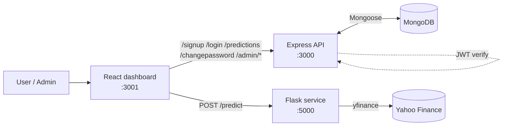

<div align="center">


</div>

My MSc capstone: a full-stack platform where users sign up, request stock data for a ticker and timeframe, see it charted, and keep a history of their requests, while administrators manage users and review activity.

> [!NOTE]
> The prediction service is a **baseline**. `/predict` currently fetches recent closing prices from Yahoo Finance (`yfinance`) and returns them for charting. A `LinearRegression` model and preprocessing helpers are included but are not wired into the endpoint yet. See the [roadmap](#-roadmap).

## ✨ Features

- 🔐 **Authentication:** sign-up and login with `bcrypt`-hashed passwords and JWT sessions, plus change password
- 🛡️ **Role-based admin area:** admins can list users (sign-up and last-login dates), review everyone's predictions and create other admins
- 📈 **Interactive dashboard:** ticker and timeframe form (days, weeks, months, years) with Chart.js price charts
- 🗂️ **Prediction history:** each user's saved requests, newest first
- 🧩 **Three small services** with clear boundaries: React UI, Express API, Flask data service

## 🏗️ Architecture



## 🔌 API reference

### Express API (`:3000`)

| Method | Endpoint | Auth | Purpose |
|---|---|---|---|
| `POST` | `/signup` | none | Register a user |
| `POST` | `/login` | none | Returns a JWT and the `isAdmin` flag |
| `POST` | `/predict` | JWT | Save a prediction for the current user |
| `GET` | `/predictions` | JWT | List the current user's predictions |
| `POST` | `/changepassword` | JWT | Change password (requires the current one) |
| `POST` | `/create-admin` | Admin | Create an admin user |
| `GET` | `/admin/users` | Admin | List users |
| `GET` | `/admin/predictions` | Admin | List all predictions with user emails |

### Flask service (`:5000`)

| Method | Endpoint | Body | Returns |
|---|---|---|---|
| `POST` | `/predict` | `{ "features": "AAPL", "timeframe": "days" }` | `{ "prediction": [closing prices] }` |

## 🚀 Getting started

**Prerequisites:** Node.js 18+, Python 3.10+, MongoDB running locally (or a connection string).

```bash
git clone https://github.com/Brian-Dol/stock-prediction-platform.git
cd stock-prediction-platform
```

**1. Express API**

```bash
cd backend
cp .env.example .env        # set JWT_SECRET (the API refuses to start without it)
npm install
npm start
```

**2. Flask service**

```bash
cd ml-service
python -m venv venv
source venv/bin/activate    # Windows: venv\Scripts\activate
pip install -r requirements.txt
python -m app.main
```

**3. React frontend**

```bash
cd frontend
npm install
npm start                   # served on http://localhost:3001
```

The frontend calls the API at `http://localhost:3000` and the Flask service at `http://127.0.0.1:5000`.

## 📁 Project structure

```text
stock-prediction-platform/
├── frontend/      React app (dashboard, auth pages, admin pages, charts)
├── backend/       Express API, Mongoose models (User, Prediction)
└── ml-service/    Flask app, yfinance data collection, LinearRegression baseline
```

## 🧰 Tech stack

| Layer | Technology |
|---|---|
| Frontend | React 18, React Router, Material UI, Bootstrap, Chart.js |
| API | Node.js, Express, Mongoose, bcryptjs, jsonwebtoken |
| Data service | Flask, pandas, yfinance, scikit-learn |
| Database | MongoDB |

## 🗺️ Roadmap

- [ ] Wire a trained model into `/predict` (the baseline only returns historical closes)
- [ ] Add token expiry, rate limiting and request validation on the API
- [ ] Move API base URLs into frontend environment variables
- [ ] Docker Compose for the whole stack
- [ ] Automated tests for the API and ML service

## 👤 Author

**Brian Dol**, Senior Full Stack Engineer · [Portfolio](https://portfolio.dol-brian23.workers.dev/) · [LinkedIn](https://linkedin.com/in/brian-dol-31a06115a/)
